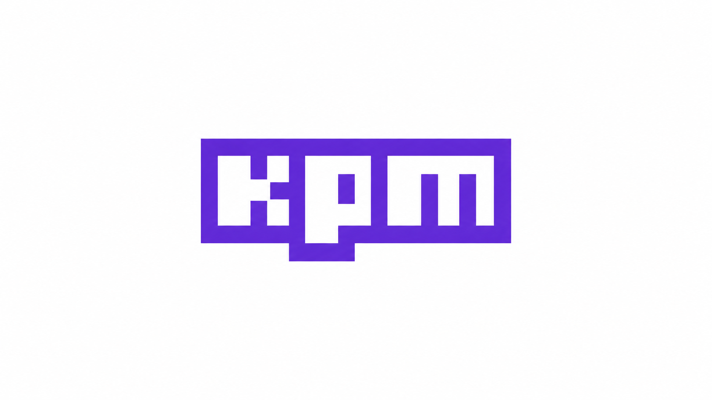

# KPM — Kotlin Package Manager

Manage Kotlin dependencies and publish libraries with npm-style commands.



Keep your package's dependencies, version, and publishing metadata in one
`package.yml`. KPM creates version commits and Git tags, and its Gradle plugin
configures Maven Central publishing and signing for you.

For maintainers of Kotlin/JVM and Kotlin Multiplatform libraries. Available on
macOS, Linux, and Windows, with bundled x64 and ARM64 binaries.

[Installation](#installation) · [Quick start](#quick-start) · [Examples](#examples) · [Commands](#command-reference) · [Package metadata](#packageyml-reference) · [MIT license](LICENSE)


## Installation

Install the CLI from npm:

```sh
npm install --global @composablehorizons/kpm
kpm --version
```

Requires **Node.js 18+** and npm. The package includes a native binary for each
supported platform; using the published CLI does not require Go.

Your library needs a Gradle wrapper and JDK 17+. Git is required for version
commits and tags. Publishing also needs a Maven Central namespace, a Central
Portal user token, and a GPG signing key; see [publishing credentials](#publishing-credentials).

## Quick start

Configure KPM in your library before running package commands.

### 1. Configure plugin repositories

In `settings.gradle.kts`:

```kotlin
pluginManagement {
    repositories {
        mavenCentral()
        gradlePluginPortal()
    }
}
```

### 2. Add the Gradle plugin

In `build.gradle.kts`:

```kotlin
plugins {
    id("com.composables.kpm") version "0.1.1"
}
```

### 3. Add package metadata

Create `package.yml` next to `build.gradle.kts` and replace the example values:

```yaml
name: My Kotlin Library
description: Reusable Kotlin tools for my apps.
version: 0.1.0-SNAPSHOT

publishing:
  groupId: com.example
  artifactId: my-library
  url: https://github.com/example/my-library
  licenses:
    - name: MIT License
      url: https://github.com/example/my-library/blob/main/LICENSE
  developers:
    - id: example
      name: Example Developer
      email: developer@example.com
  scm:
    connection: scm:git:https://github.com/example/my-library.git
    developerConnection: scm:git:ssh://git@github.com/example/my-library.git
    url: https://github.com/example/my-library
```

### 4. Verify setup

Run from the directory containing `package.yml`:

```sh
kpm version
kpm publish --dry-run
```

## Features

- **One metadata file:** `package.yml` supplies the version, Maven coordinates,
  license, developers, and SCM information for the generated POM.
- **Dependency management:** install, uninstall, list, check outdated versions, and update dependencies through Gradle using your project repositories and credentials.
- **Semantic versioning:** choose `patch`, `minor`, `major`, an exact version, or
  a version from a Git tag.
- **Release commits and tags:** version changes create a commit and annotated
  tag by default, with configurable messages and prefixes.
- **Gradle publishing:** the plugin configures Maven Central publication and
  signing using standard Gradle credentials.
- **Terminal and CI workflows:** use the same commands locally or in GitHub
  Actions, with a dry run to inspect the publishing task graph.

## Examples

### Manage dependencies

Apply the KPM plugin alongside your Kotlin or Android plugin, configure your targets, and declare repositories in Gradle (`mavenCentral()`, `google()`, or your private Maven repository). Both the CLI and Gradle plugin must support dependency commands. Dependency versions below are illustrative.

```sh
# Install and save an exact version (i is an alias for install)
kpm i org.jetbrains.kotlinx:kotlinx-coroutines-core:1.10.2

# Omit the version to look up and save the latest release through Gradle
kpm i org.jetbrains.kotlinx:kotlinx-coroutines-core

# Expose a dependency to consumers, or select a platform
kpm i org.jetbrains.kotlinx:kotlinx-coroutines-core:1.10.2 --api
kpm i androidx.activity:activity-compose:1.10.1 --target android

# Resolve and download the dependencies already declared in package.yml
kpm i

kpm list
kpm outdated
kpm update
kpm uninstall androidx.activity:activity-compose --target android
```

Omitting `--target` adds to `commonMain` in a Kotlin Multiplatform project, or the main configuration in a Kotlin/JVM or Android project. `--api` exposes a dependency; otherwise new dependencies use `implementation`. Reinstalling an existing dependency preserves its scope unless `--api` or `--implementation` is specified. Flags may appear before or after coordinates, and install/uninstall accept multiple packages.

KPM preserves the existing manifest structure and expands shorthand lists when explicit targets or scopes are needed. Install and uninstall also resolve dependencies through Gradle; a resolution failure restores the original manifest. Uninstall without a target removes the dependency from every target.

`list` (`ls`) shows declared and resolved versions. `outdated` shows current, wanted (matching the declared version selector), and latest release versions. `update` (`up`) refreshes Gradle resolution within declared constraints without rewriting `package.yml`. An exact version stays pinned unless Gradle conflict resolution selects a higher compatible version. To explicitly move a declaration to the latest release, run `kpm i group:artifact`.

```sh
kpm update org.jetbrains.kotlinx:kotlinx-coroutines-core
kpm update --save
```

`--save` also writes resolved versions back to exact declarations; dynamic selectors remain intact. Version selectors use Gradle syntax, such as `1.+` or `[1.0,2.0)`, rather than npm's `^` and `~` syntax. Install/uninstall write enabled Gradle dependency locks; update refreshes all enabled locks or uses `--update-locks` for named packages. KPM uses Gradle's dependency cache and lockfiles, without creating a separate package lockfile. Dependency CLI tasks disable the Gradle configuration cache; normal builds still support it.

### Create and publish a release

Configure [publishing credentials](#publishing-credentials) first.

Start with a clean Git working tree:

```sh
./gradlew check
kpm version patch
kpm publish
```

With the quick-start metadata, `kpm version patch` changes `0.1.0-SNAPSHOT` to `0.1.0`, commits `package.yml`, and creates the annotated tag `v0.1.0`.

`kpm publish` builds the configured publications, signs them when signing credentials are provided, and uploads them for automatic release on Maven Central. It returns after upload without waiting for Central validation or download availability. It uses your project's Gradle wrapper. It does not run your test suite or push Git changes; those are separate steps you control.

For later releases, use `patch`, `minor`, `major`, or an exact version:

```sh
kpm version minor
kpm version 1.0.0
```

### Change metadata without a commit or tag

```sh
kpm version minor --no-git-tag-version
```

This updates `package.yml` only, so you can review or commit the change yourself.

### Read a version from Git

```sh
kpm version from-git --no-git-tag-version
```

This uses the nearest reachable Git tag with the configured prefix removed.
The default tag prefix is `v`.

## Command reference

| Command | What it does |
| --- | --- |
| `kpm install` / `kpm i` | Resolves and downloads declared dependencies through Gradle. |
| `kpm i group:artifact[:version]` | Installs and saves a dependency; looks up the latest release when version is omitted. |
| `kpm uninstall group:artifact` | Removes a dependency; aliases: `remove`, `rm`. |
| `kpm list` / `kpm ls` | Shows declared dependencies and resolved versions. |
| `kpm outdated` | Checks current, wanted, and latest release versions. |
| `kpm update` / `kpm up` | Refreshes resolution within declared constraints; accepts package names and `--save`. |
| `kpm --version` | Prints the installed KPM version. |
| `kpm version` | Prints the current library version. |
| `kpm version patch` | Increments the patch version, or removes its prerelease suffix. |
| `kpm version minor` | Selects the next minor release. |
| `kpm version major` | Selects the next major release. |
| `kpm version 1.2.3` | Sets an exact semantic version. |
| `kpm version from-git` | Uses the nearest reachable Git tag, with the configured prefix removed. |
| `kpm publish --dry-run` | Shows the publishing task graph without executing it. |
| `kpm publish` | Publishes the current version through Gradle. |

Dependency commands accept `--target NAME`; install also accepts `--api` or `--implementation`. Only `api` and `implementation` scopes are supported.

Version commands accept these options before or after the version argument:

| Option | Use it to… |
| --- | --- |
| `--no-git-tag-version` | Update `package.yml` without committing or tagging. |
| `--message 'Release %s'` | Customize the commit and tag message; `%s` becomes the version. |
| `--tag-version-prefix release-` | Change the default `v` tag prefix. |
| `--allow-same-version` | Explicitly permit keeping the current version. |

Version changes require a clean working tree unless you use `--no-git-tag-version`. KPM checks for an existing tag before updating metadata. Version commands never push to a remote.

For all command options, run:

```sh
kpm --help
```

## Publishing credentials

Before publishing, you'll need a [Maven Central account and registered namespace](https://central.sonatype.org/publish/requirements/), a Central Portal user token, and a GPG signing key.

KPM uses the standard Gradle publishing properties. Set them through environment variables, your user-level Gradle configuration, or CI secrets. For example:

```sh
export ORG_GRADLE_PROJECT_mavenCentralUsername="YOUR_CENTRAL_TOKEN_USERNAME"
export ORG_GRADLE_PROJECT_mavenCentralPassword="YOUR_CENTRAL_TOKEN_PASSWORD"
export ORG_GRADLE_PROJECT_signingInMemoryKey="$(cat /path/to/private-signing-key.asc)"
export ORG_GRADLE_PROJECT_signingInMemoryKeyId="YOUR_KEY_ID"
export ORG_GRADLE_PROJECT_signingInMemoryKeyPassword="YOUR_KEY_PASSWORD"
```

The signing key must be ASCII-armored. The key ID and password depend on your key configuration. Keep credentials out of `package.yml` and version control.

## Release with GitHub Actions

Install a pinned KPM version in your workflow.

This workflow publishes when you push a `v*` tag. It verifies that the tag matches `package.yml`, runs your checks, then publishes from that tagged commit:

```yaml
name: Release
on:
  push:
    tags: ['v*']

permissions:
  contents: read

concurrency:
  group: release
  cancel-in-progress: false

jobs:
  publish:
    runs-on: macos-latest
    steps:
      - uses: actions/checkout@v5
      - uses: actions/setup-java@v5
        with:
          distribution: temurin
          java-version: '17'
      - uses: actions/setup-node@v5
        with:
          node-version: '22'
      - uses: gradle/actions/setup-gradle@v5
      - name: Install KPM
        run: npm install --global @composablehorizons/kpm@0.1.0
      - name: Verify release version
        run: test "v$(kpm version)" = "$GITHUB_REF_NAME"
      - run: ./gradlew check
      - name: Publish to Maven Central
        env:
          ORG_GRADLE_PROJECT_mavenCentralUsername: ${{ secrets.OSSRH_USERNAME }}
          ORG_GRADLE_PROJECT_mavenCentralPassword: ${{ secrets.OSSRH_PASSWORD }}
          ORG_GRADLE_PROJECT_signingInMemoryKey: ${{ secrets.SIGNING_KEY }}
          ORG_GRADLE_PROJECT_signingInMemoryKeyId: ${{ secrets.SIGNING_KEY_ID }}
          ORG_GRADLE_PROJECT_signingInMemoryKeyPassword: ${{ secrets.SIGNING_PASSWORD }}
        run: kpm publish
```

Add the corresponding secrets to your repository or organization. The example uses macOS to accommodate iOS targets; choose a runner and any additional SDK setup that match your library's targets.

With this workflow in place, create the version locally and push the commit and tag. GitHub Actions handles publication:

```sh
kpm version patch
git push --follow-tags
```

## package.yml reference

This example includes every supported publishing field. Dependencies are described below:

```yaml
name: My Kotlin Library
description: Reusable Kotlin tools for my apps.
version: 0.1.0

publishing:
  groupId: com.example
  artifactId: my-library
  url: https://github.com/example/my-library

  licenses:
    - name: MIT License
      url: https://github.com/example/my-library/blob/main/LICENSE
      distribution: repo # Optional

  developers:
    - id: example
      name: Example Developer
      email: developer@example.com # Optional
      url: https://github.com/example # Optional

  scm:
    connection: scm:git:https://github.com/example/my-library.git
    developerConnection: scm:git:ssh://git@github.com/example/my-library.git
    url: https://github.com/example/my-library

  issueManagement: # Optional; include both fields when present
    system: GitHub Issues
    url: https://github.com/example/my-library/issues
```

### Fields

| Field | Required | Purpose |
| --- | --- | --- |
| `name` | Yes | Display name of the library. |
| `description` | Yes | Summary of what the library does. |
| `publishing.groupId` | Yes | Maven namespace, such as `com.example`. Also sets the Gradle project group. |
| `publishing.artifactId` | Yes | Maven artifact name, such as `my-library`. |
| `version` | Yes | Package version in semantic version format, such as `1.2.3` or `1.2.3-SNAPSHOT`. Also sets the Gradle project version. |
| `publishing.url` | Yes | Library homepage or repository URL. |
| `publishing.licenses` | Yes | A list containing at least one license. |
| `publishing.licenses[].name` | Yes | License name. |
| `publishing.licenses[].url` | Yes | URL of the license text. |
| `publishing.licenses[].distribution` | No | Maven license distribution value, commonly `repo`. |
| `publishing.developers` | Yes | A list containing at least one developer. |
| `publishing.developers[].id` | Yes | Developer identifier, such as a GitHub username. |
| `publishing.developers[].name` | Yes | Developer or organization display name. |
| `publishing.developers[].email` | No | Developer contact email. |
| `publishing.developers[].url` | No | Developer website or profile URL. |
| `publishing.scm` | Yes | Source repository details. |
| `publishing.scm.connection` | Yes | Read-only SCM connection, such as `scm:git:https://github.com/example/my-library.git`. |
| `publishing.scm.developerConnection` | Yes | Developer SCM connection, such as `scm:git:ssh://git@github.com/example/my-library.git`. |
| `publishing.scm.url` | Yes | Browser URL for the source repository. |
| `publishing.issueManagement` | No | Issue tracker details. |
| `publishing.issueManagement.system` | When `publishing.issueManagement` is present | Tracker name, such as `GitHub Issues`. |
| `publishing.issueManagement.url` | When `publishing.issueManagement` is present | URL of the issue tracker. |

The `publishing` block is optional. When omitted, KPM sets the package version without configuring Maven publishing. The fields marked required inside `publishing` are required only when publishing is configured. `name`, `description`, and `version` remain at the top level.

Existing top-level publishing fields remain supported until 1.0.0 and produce a deprecation warning. Move them under `publishing` to migrate. If both formats are present, the nested block takes precedence as a whole; KPM does not merge the formats.

All text fields must be non-empty strings when supplied. Add multiple entries under `licenses` or `developers` as needed. Publishing metadata is written to the generated Maven POM.

### Dependencies

A list directly under `dependencies` defaults to implementation dependencies in `commonMain` (KMP) or the main source set (Kotlin/JVM and Android):

```yaml
dependencies:
  - org.jetbrains.kotlinx:kotlinx-coroutines-core:1.10.2
```

Use a mapping to select targets and, optionally, scopes:

```yaml
dependencies:
  common:
    api:
      - org.jetbrains.kotlinx:kotlinx-coroutines-core:1.10.2
    implementation:
      - org.jetbrains.kotlinx:kotlinx-serialization-json:1.8.1
  android:
    - androidx.activity:activity-compose:1.10.1
  jvm:
    - org.slf4j:slf4j-api:2.0.17
```

Versions are illustrative. Each target can use a list (implementation) or a mapping with `api` and/or `implementation`. KMP targets map to `<target>Main`; shared source sets such as `iosMain` use `ios`. Targets must already exist in Gradle, and common dependencies are inherited through Kotlin's source-set hierarchy. On standalone JVM/Android projects, explicit `jvm`/`android` targets map to the main configurations. Duplicate coordinates within one target are rejected, even across scopes. Use either a top-level list or a target mapping; keep targets and build settings in Gradle.

### File location

Run the CLI from the directory containing `package.yml`. It reads only that directory and reports an error if the file is missing. The Gradle plugin reads it from the project where the plugin is applied. For dependency commands and publishing, that directory must also contain the Gradle wrapper.

Apply KPM to each package project whose dependencies or publishing it should configure. Dependencies can also be declared directly in Gradle; Gradle handles conflicts and transitive resolution.

## Limitations and troubleshooting

- **Dependency resolution fails?** Check your Gradle repositories, credentials, target declarations, and requested versions. Upgrade the Gradle plugin alongside the CLI to use dependency commands.
- **No `package.yml` found?** Run from the directory containing it. The CLI does
  not search parent directories. Keep the Gradle wrapper there for publishing.
- **Working tree is dirty?** Commit or stash changes before creating a version
  commit/tag, or use `--no-git-tag-version` to update metadata only.
- **Tag already exists?** Choose a new version or check the tag prefix. KPM
  checks for an existing tag before changing the metadata.
- **Nothing was pushed?** Version commands create local commits and tags. Push
  them separately when you are ready.
- **Need to verify a release?** Run your library's checks separately. `kpm publish`
  does not run the test suite. `--dry-run` shows Gradle's task graph without
  executing publishing tasks or uploading artifacts.
- **Publishing or signing fails?** Check your Maven Central namespace, token,
  ASCII-armored signing key, and Gradle publishing properties.

## Development and contributing

Building the CLI requires Go 1.22+; the npm package build and launcher tests use
Bun. Gradle plugin development also requires JDK 17+.

```sh
# Build the native CLI for all supported platforms
bun run build

# Test the Go CLI and npm launcher
bun run test

# Test and validate the Gradle plugin
./gradlew :gradle-plugin:test :gradle-plugin:validatePlugins --console=plain
```

The [Kotlin Multiplatform example](examples/kotlin-library) uses the local plugin
through an included build. Check its JVM/Wasm compilation and generated POMs with:

```sh
./gradlew -p examples/kotlin-library compileKotlinJvm compileKotlinWasmJs generatePomFileForKotlinMultiplatformPublication generatePomFileForJvmPublication --console=plain
```

Report reproducible bugs or propose changes through the repository's issues and
pull requests. Include the command, relevant `package.yml` fields, and platform
or Gradle details. Keep credentials and private signing keys out of reports.

## License

[MIT](LICENSE) © Composable Horizons.
